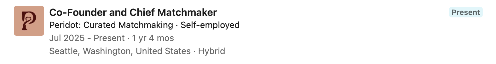
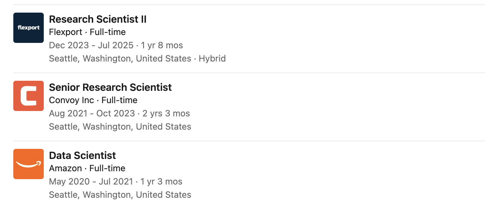
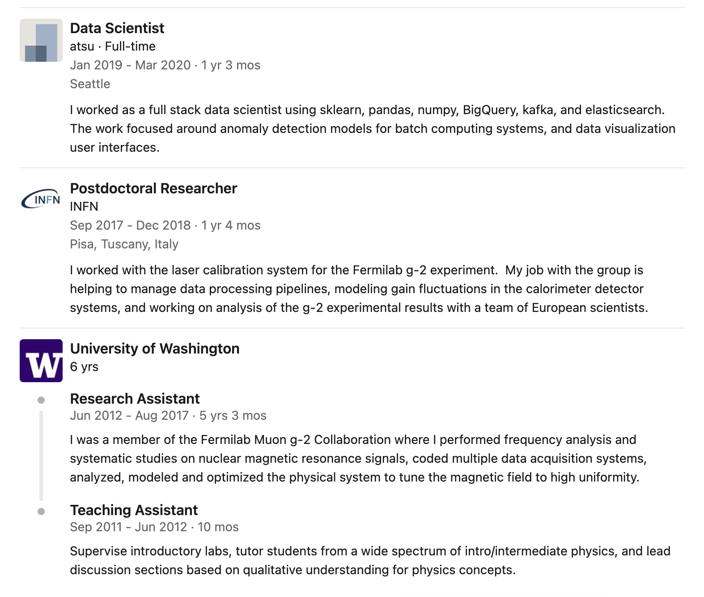
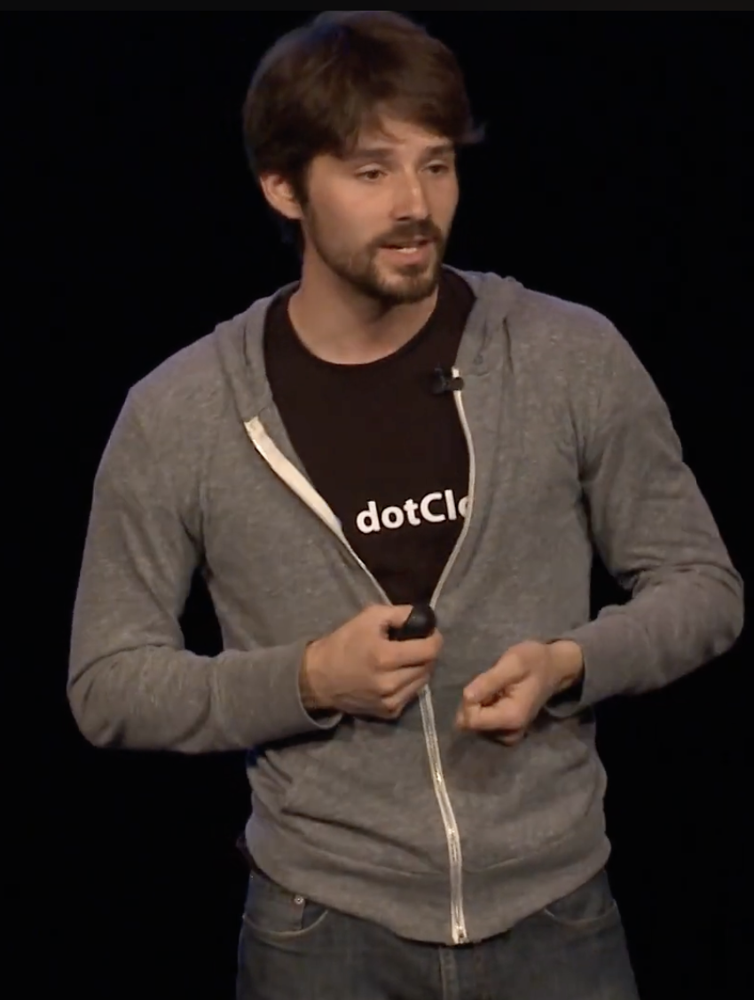
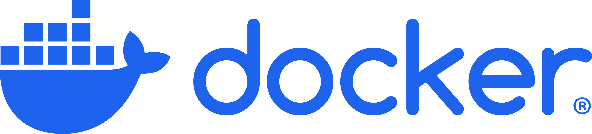
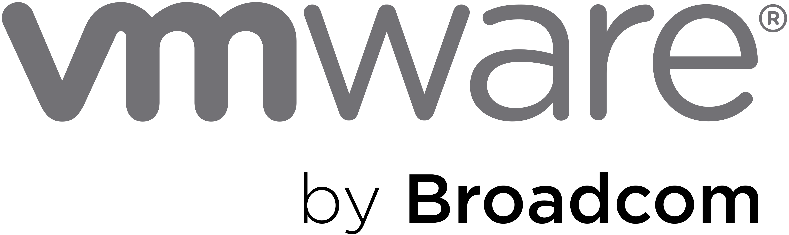
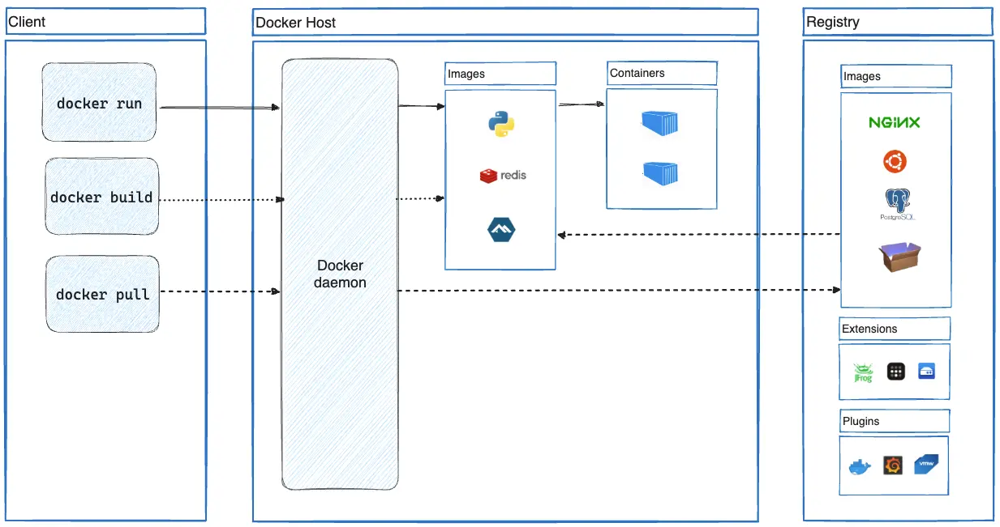
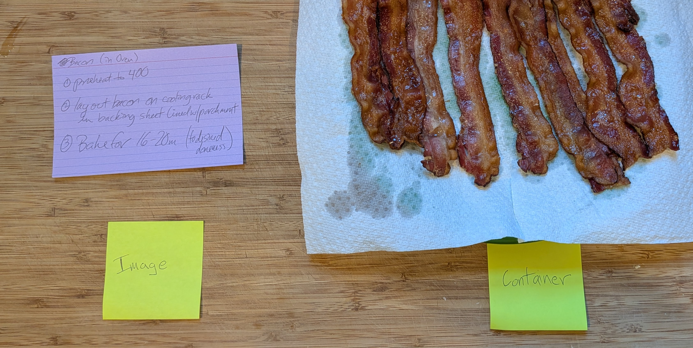
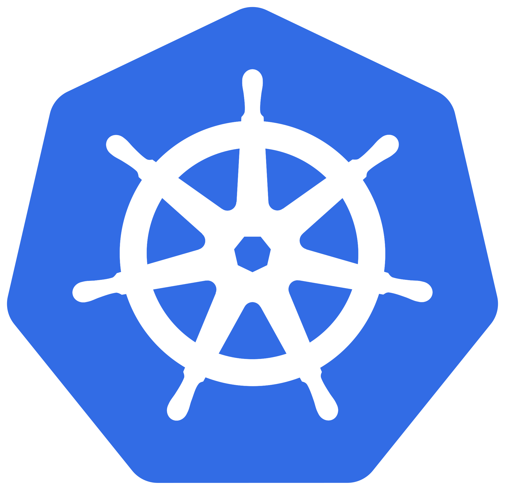

# Containers and Environments

## Preamble

<!--  -->

## Goal
**Today:** Recognize when to use a container
* Jargon
* Examples

**Tomorrow:** Practice, Practice, Practice
* Tutorial
* Workout Plan

## Motivation

<!--
another example is when you want to work but you don't have your machine so the configuration isn't the way you like it

another example is how i use cloud tools because they behave the same on every machine because they don't run local (problem of latency)

example from https://github.com/mfriedel/DS6021_F26 https://github.com/mfriedel/DS6021_F26#python-environment-setup -- this section is all about getting requirements.txt to work but ....... the problem can be bigger ...... the concept of containers lets us package up one level ...... os level virtualization
-->

### If all you're worried about it python ... a virtual environment is usually enough
### Example DS 6021 - [https://github.com/mfriedel/DS6021_F26#python-environment-setup](https://github.com/mfriedel/DS6021_F26#python-environment-setup)

## Jargon - Virtualization
* virtualization - turn a physical resource into multiple logical resources - progressive isolation

|                                                  | Technology              | Generic Term | Isolates       | Weight |
|--------------------------------------------------|-------------------------|-------------|----------------|--------|
|          | Virtual environment     | venv        | Packages       | Light (MBs)|
|  | OS-level virtualization | Container   | + User space   | Medium (10s of MBs)|
|  | Virtual machine         | VM          | + Kernel space | Heavy (GBs) |

* select the level you need based on the job

## Example - A Local Database

* Without Containers
    1. Download and install
    2. Initialize
    3. Start the server
    4. Configure environment variables
    5. Set up user/pass situation
    6. Connect

* With containers
    1. docker run -d --name redis -p 6379:6379 redis:latest
    2. connect (redis-cli -h 127.0.0.1 -p 6379)

## Enter Docker

Jargon
* Docker - software
* Docker, Inc. - company
* Docker Account - something you need to access .....
* Docker Hub - where the goods are at
* Docker Desktop - the app on your machine you use to control it all

### Jargon
* image
* container "A container is a running instance of an image." ~docs.docker.com
* layer
* Dockerfile

### Tasty Metaphor - Image v Container

# How to practice
1. Work the docs "Getting Started" -- [https://www.docker.com/trainings/](https://www.docker.com/trainings/)
    * Installation
    * Download and run your first container
    * Download and run a stack
    * Build your first image
    * Share the image
  
2. Tell some jokes
    * Get this container running
    * https://github.com/uvasds-systems/joke-container
    * Courtesy of Professor Magee
  
3. Build your own
    * Build and image of your development environment
    * Share that image
  

# References
1. What is Docker - https://docs.docker.com/get-started/docker-overview/
2. Build and share a containerized application - https://docs.docker.com/get-started/tutorials/run-an-app/
3. Containers in Data Science - https://uvads.github.io/container-basics/
4. [dotScale 2013 - Solomon Hykes - Why we built Docker](https://www.youtube.com/watch?v=3N3n9FzebAA)

# If we have time
Kubernetes. -"Docker is a container runtime technology that allows you to build, test, and deploy applications faster than traditional methods. It packages software into standardized units called containers with everything the software needs to run—including libraries, system tools, and code. Kubernetes is a container orchestration tool that allows you to scale your container systems so you can manage, coordinate and schedule containers at a vast scale." ~ [aws.amazon.com](https://aws.amazon.com/compare/the-difference-between-kubernetes-and-docker/)

