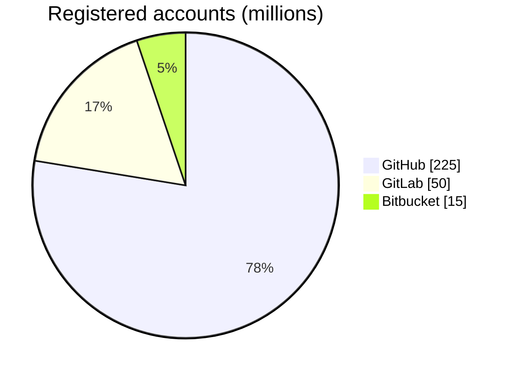
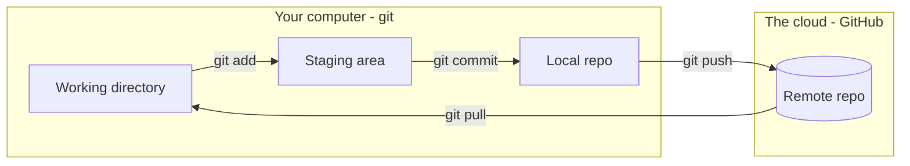
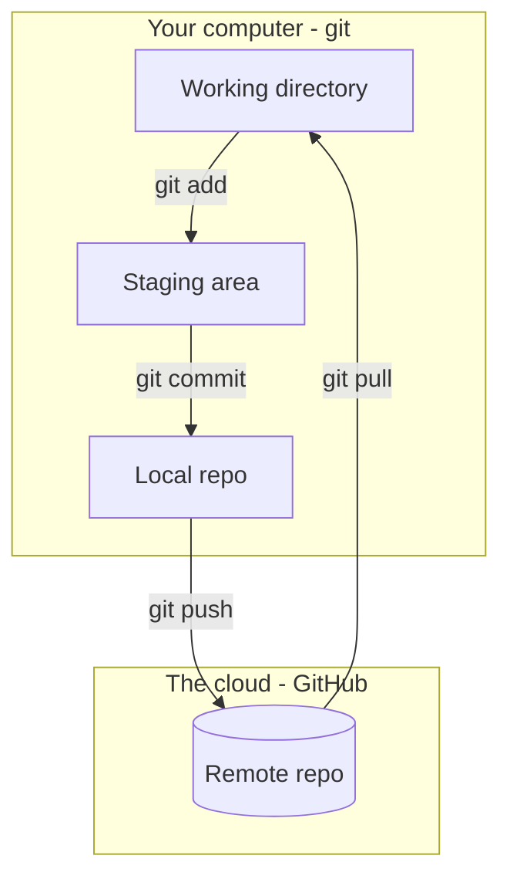

# Are You Having Trouble Gitting It?

## Preamble

*[xkcd 1597](https://xkcd.com/1597/) by Randall Munroe, CC BY-NC 2.5*

**Nobody memorizes git.**

## Goal
**Today:** The on-ramp
* History
* Motivation
* Jargon
* Under the hood
* GitHub is social media
* The standard workflow
* Live demo

**"Tomorrow":** Practice, Practice, Practice
* [GitHub badge](../../badges/github.md)
* Work on a side project using GitHub
* Work on an open source project [Ambitious]
<!-- TODO: add the rest of tomorrow's plan here -->

## Motivation and History

### Why GitHub

1. **Collaboration** - the industry standard for working on code together
2. **Portfolio** - show off the work you did

### Timeline
| Year | Event | Motivation |
|---|---|---|
| **2005** | Linus Torvalds writes git | necessity and philosophy [ai take](wg)|
| **2008** | GitHub launches | add social layer to git |
| **2012** | 100M$ Series A raise (first external funds) | :eyes: |
| **2018** | Microsoft buys GitHub for $7.5B | :eyes:     :eyes: |
| **2021** | GitHub Copilot | AI integration |
| **2026** | AI agents open over 40% of pull requests | |

### Today's Landscape for Social Coding

## Jargon

| Logo | Term | What it is |
|---|---|---|
|  | **git** | Software - version control |
|  | **GitHub** | Company - owned by Microsoft |
|  | **github.com** | Website - the front end |

| Term | Source | Note |
|---|---|---|
| repository (repo) | git | folder full of files (source code and metadata) |
| README | General computing | first thing someone sees in a repo |
| GFM | GitHub | GitHub flavored markdown)
| commit | git | a state of the repository |
| branch | git | an independent line of commits |
| fork | GitHub | your copy of someone else's repo |
| pull request (PR) | GitHub | message from your repo back to the original |

## Under the Hood
Understanding the relationship between git and GitHub
* **git** runs on your computer.
* **git** runs on the **GitHub** servers.
* **git** sends messages back and forth at your command.
* **git** maintains two independed repositories (local and remote)

### Core git commands

| Command | What it does | Dangerous |
|---|---|---|
| `git clone` | make a local copy of a repo | no |
| `git status` | state of the repository | No |
| `git add` | stage changes | No |
| `git commit` | save changes (in repo) | No |
| `git push` | synch changes to remote | Yes |
| `git pull` | synch changes from repote | Yes |

A challenge is the so-called **triple save**

## GitHub is Social Media

**Put yourself on high alert.** All the pitfalls of social media lurk just under the surface.

### Let's look at a profile
<!-- https://github.com/UVADS/orientation-technical/blob/main/workshops/zzold/lessons/arXiv/lesson-github.md -->

* **Black box** - contact info
* **Blue box** - pinned repositories, what you choose to highlight
* **Red box** - the commit graph - **WARNING!!!**

### Data science thinking time - the commit graph

1. What questions **can** we answer from this data?
2. What questions can we **not** answer?
3. What additional data would move a question from 2 to 1?

### Bend it to your purpose
* **Portfolio** - pin your best work, write the README
* **Networking** - follow faculty, alumni, projects you use
* **Shields up** - profiles can discourage and intimidate. Have a friend to talk to.

## The Standard Workflow

You are a data scientist. This is the loop you will see every day.

| Step | What you do | Whose word |
|---|---|---|
| 1. **Fork** | Not your repo? Make your own copy first | GitHub |
| 2. **Branch** | Step off of main | git |
| 3. **Commit** | Save points | git |
| 4. **Pull request** | Ask to come back | GitHub |
| 5. **Review** | A human (or an agent) looks | GitHub |
| 6. **Merge** | Back on main | git |

* Your own repo? Skip step 1.

<!-- TODO: workflow graphic goes here - see To-do -->

## Live Demo - Clicking on Everything
* README
* Commits and history
* Blame
* Branches
* Issues
* Pull requests
* Edit a file in the browser &rarr; commit &rarr; PR
* Insights

## Homework

### Earn the [GitHub badge](../../badges/github.md)

## When in doubt, see the [Preamble](#preamble)

## To-do
*Speaker notes - remove before the talk.*

- [ ] **Software, not data** - git is version control for software and GitHub hosts software. Neither is where the data lives. Find the right moment in the talk for this.
- [ ] **Commit graph questions** - this is a presentation, not a workshop. Decide how to deliver the three questions. The old lesson had a fourth: what data would make the answers to question 1 more accurate?
- [ ] **"Think of it as" column** - rewrite, it can be better.
- [ ] **Workflow graphic** - find one made by GitHub. Candidate: the [GitHub flow picture on Microsoft Learn](https://learn.microsoft.com/en-sg/training/modules/introduction-to-github/3-components-of-github-flow). Check reuse terms before embedding.

# Sources
* github workflow figure - https://learn.microsoft.com/en-sg/training/modules/introduction-to-github/3-components-of-github-flow
* github workflow figure - https://izymes.com/wp-content/uploads/2022/06/pr-dependencies-git-flow.png    
