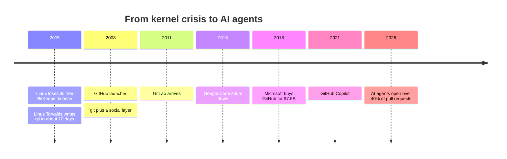
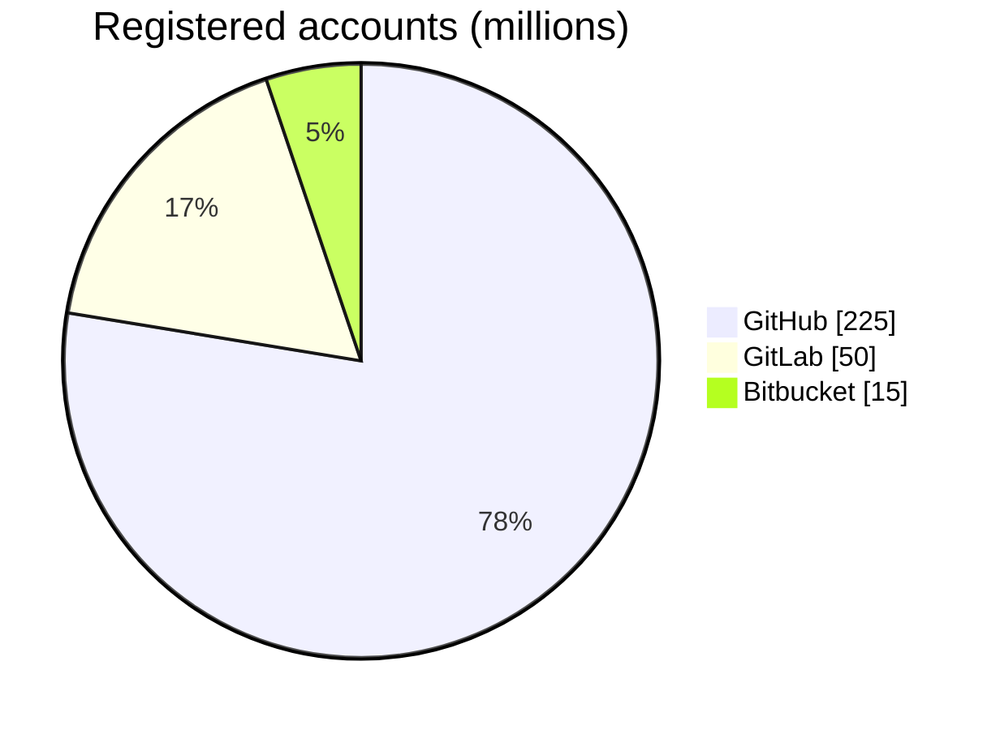
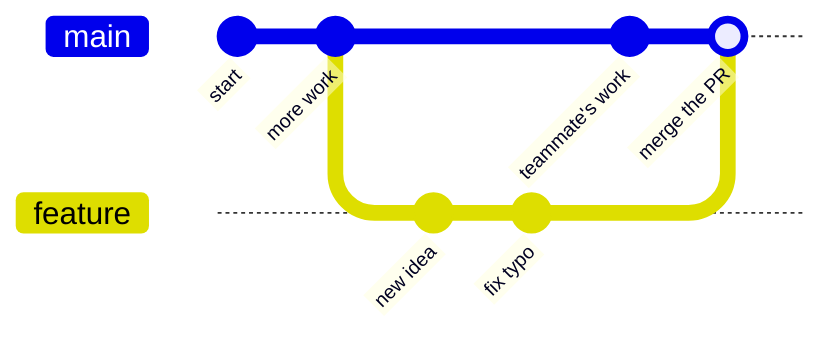
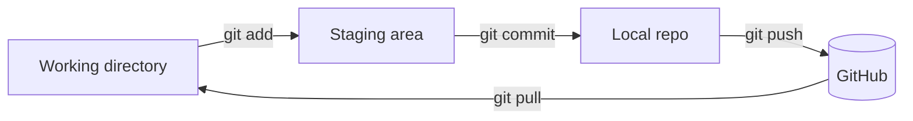

# Are You Having Trouble Gitting It?

## Preamble

*[xkcd 1597](https://xkcd.com/1597/) by Randall Munroe, CC BY-NC 2.5*

**Nobody memorizes git.** Know a few moves. When it breaks, start over.

## Goal
**Today:** The on-ramp
* History and motivation
* Jargon
* GitHub is social media
* The standard workflow
* A peek under the hood

**Tomorrow:** Practice, Practice, Practice
* [GitHub badge](../../badges/github.md)

## History

### Why Linus made git
* Fast
* Distributed - everyone has the whole history
* Trust nothing - every version is checksummed

### The competitors

| | Since | Story |
|---|---|---|
| SourceForge | 1999 | The old guard |
| Google Code | 2006 | Shut down in 2016 |
| Bitbucket | 2008 | Atlassian - pairs with Jira |
| GitLab | 2011 | Open core - host it yourself |

### Who won?

*Self-reported and overlapping - plenty of people have more than one account.*

### Why Microsoft paid $7.5B
* Developers are the customer
* Open source is where the work happens
* On-ramp to Azure, VS Code, and Copilot

### And now: AI
* March 2026 - agents open **17%** of pull requests
* September 2026 - agents open **over 40%**
* The workflow below is the same one the agents use

## Motivation - Why Data Science Lives Here

* **Reproducibility** - code + history = your methods section
* **Your tools live here**
* **It renders** - notebooks, markdown, CSVs, diagrams (this page!)
* **Collaboration** - classes, capstones, labs
* **Portfolio** - employers look

### Your tools live here ... mostly

| Built on GitHub | Mirror only |
|---|---|
| pandas, NumPy, SciPy, scikit-learn | R (Subversion) |
| matplotlib, Jupyter, tidyverse | Linux (mailing list) |
| PyTorch, TensorFlow, Hugging Face | git itself (mailing list) |
| Python, VS Code, uv, DuckDB, Spark | PostgreSQL (mailing list) |

* GitHub &ne; git &ne; open source

### Free and open culture

| What | License family | Examples |
|---|---|---|
| Code | Software licenses | MIT, BSD, Apache, GPL |
| Docs, data, slides, comics | Creative Commons | CC BY, CC BY-NC, CC0 |
| No license at all | All rights reserved | public &ne; open |

* Creative Commons says: do not use CC for software
* The xkcd up top? CC BY-NC
<!-- * Live example: look at the LICENSE file in this repo -->

### One caveat
* git is for code, not big data

## Jargon

| Term | What it is |
|---|---|
| **git** | Software - version control |
| **GitHub** | Company - owned by Microsoft |
| **github.com** | Website - the front end |

| Term | Think of it as |
|---|---|
| repository (repo) | Project folder + its whole history |
| commit | A save point with a note |
| branch | A parallel timeline |
| fork | Your own copy of someone else's repo |
| pull request (PR) | "Please take my changes" |
| README | The welcome mat |

## GitHub is Social Media

**Put yourself on high alert.** All the pitfalls of social media lurk just under the surface.

### Let's look at a profile
<!-- https://github.com/UVADS/orientation-technical/blob/main/workshops/zzold/lessons/arXiv/lesson-github.md -->

* **Black box** - contact info
* **Blue box** - pinned repositories, what you choose to highlight
* **Red box** - the commit graph - **WARNING!!!**

### Data science thinking time - the commit graph

1. What questions **can** we answer from this data?
2. What questions can we **not** answer?
3. What additional data would move a question from 2 to 1?

### Bend it to your purpose
* **Portfolio** - pin your best work, write the README
* **Networking** - follow faculty, alumni, projects you use
* **Shields up** - profiles can discourage and intimidate. Have a friend to talk to.

## The Standard Workflow

1. **Branch** - step off of main
2. **Commit** - save points
3. **Pull request** - ask to come back
4. **Review** - a human (or an agent) looks
5. **Merge** - back on main

* Not your repo? **Fork** first, then the same five steps

## Live Demo - Clicking on Everything
* README
* Commits and history
* Blame
* Branches
* Issues
* Pull requests
* Edit a file in the browser &rarr; commit &rarr; PR
* Insights

## Under the Hood

### The few moves

| Command | What it does |
|---|---|
| `git clone` | Get a copy |
| `git status` | Where am I? |
| `git add` | Stage it |
| `git commit` | Save point |
| `git push` | Send it up |
| `git pull` | Bring it down |

### And when it all goes wrong
* See the Preamble

## Homework

### Earn the [GitHub badge](../../badges/github.md)

## Sources
* [GitHub Octoverse 2026](https://github.blog/news-insights/octoverse/octoverse-commits-pushes-reach-new-highs-in-2026-as-developers-build-with-agents/) - 225M+ accounts, agent pull requests
* [Source code hosting market share 2026](https://safeguard.sh/resources/blog/source-code-hosting-market-share-2026) - GitLab accounts, survey data
* [GitHub statistics](https://www.getpanto.ai/blog/github-statistics) - Bitbucket accounts
* [Why R is not on GitHub](https://stat.ethz.ch/pipermail/r-devel/2014-August/069609.html)
* [Creative Commons on software](https://creativecommons.org/faq/#can-i-apply-a-creative-commons-license-to-software)
