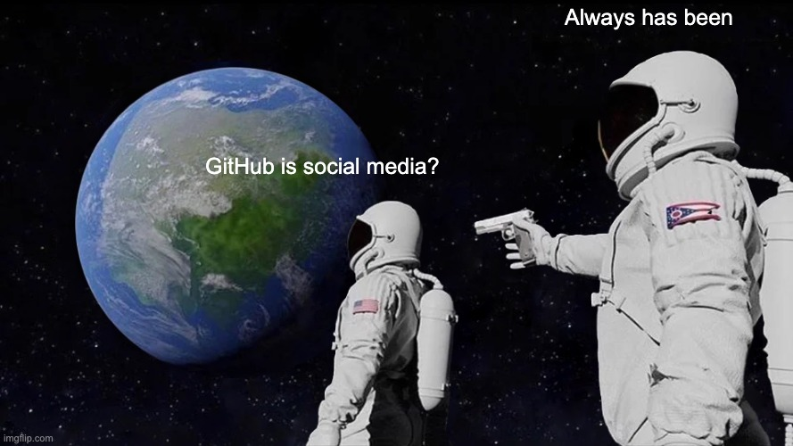
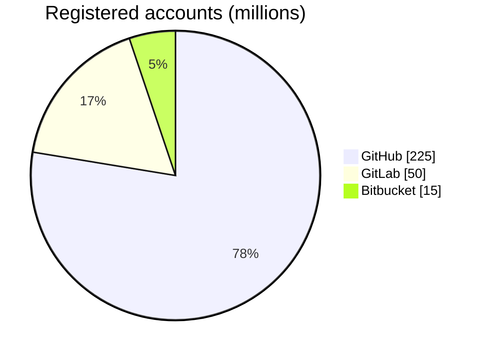
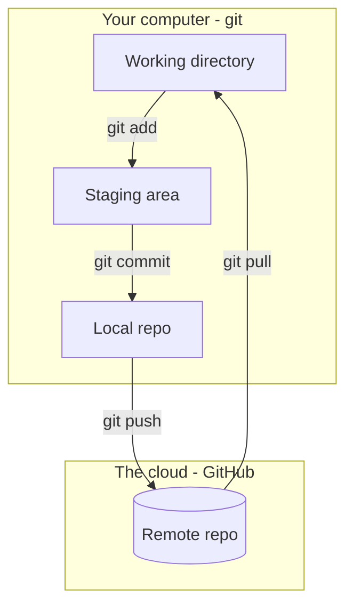

# Are You Having Trouble Gitting It?

## Preamble

*[xkcd 1597](https://xkcd.com/1597/) by Randall Munroe, CC BY-NC 2.5*

**Nobody memorizes git.**

## Goal
**Today:** The on-ramp
* History and Motivation
* Motivation
* Jargon
* Under the hood
* GitHub is social media
* The standard workflow
* Live demo and Q&A

**"Tomorrow":** Practice, Practice, Practice
* [GitHub badge](../../badges/github.md)
* Work on a side project using GitHub
* Work on an open source project [Ambitious]

## Motivation and History

### Why GitHub

1. **Collaboration** - the industry standard for working on code together
2. **Portfolio** - show off the work you did

### Timeline
| Year | Event | Motivation |
|---|---|---|
| **2005** | Linus Torvalds writes git | necessity and philosophy [ai take](wg.md)|
| **2008** | GitHub launches | add social layer to git |
| **2012** | 100M$ Series A raise (first external funds) | :eyes: |
| **2018** | Microsoft buys GitHub for $7.5B | :eyes:     :eyes: |
| **2021** | GitHub Copilot | AI integration |
| **2026** | AI agents open over 40% of pull requests | |

### Today's Landscape for Social Coding

## Jargon

| Logo | Term | What it is |
|---|---|---|
|  | **git** | Software - version control |
|  | **GitHub** | Company - owned by Microsoft |
|  | **github.com** | Website - the front end |

| Term | Source | Note |
|---|---|---|
| repository (repo) | git | folder full of files (source code and metadata) |
| README | General computing | first thing someone sees in a repo |
| GFM | GitHub | GitHub flavored markdown)
| commit | git | a state of the repository |
| branch | git | an independent line of commits |
| fork | GitHub | your copy of someone else's repo |
| pull request (PR) | GitHub | message from your repo back to the original |

## Under the Hood
Understanding the relationship between git and GitHub
* **git** runs on your computer.
* **git** runs on the **GitHub** servers.
* **git** sends messages back and forth at your command.
* **git** maintains two independed repositories (local and remote)

### Core git commands

| Command | What it does | 
|---|---|
| `git clone` | make a local copy of a repo | 
| `git status` | state of the repository | 
| `git add` | stage changes | 
| `git commit` | save changes (in repo) | 
| `git push` | synch changes to remote | 
| `git pull` | synch changes from repote | 

### Major Workflow Challenges
1. The so-called **"triple save"**
2. Local v remote
3. social media trap .....

## GitHub is Social Media

1. You make a profile with a tech company that got venture capital funding and made a multi billion dollar exit
2. You give that tech company a ton of info and let it crawl all over your computer
3. Whenever you want to tell your "friends" about something you send them a GitHub instead of calling them
4. You share source code .... instead of pictures of avocado toast.
5. If you're really good at GitHub it can help you get a job. (This parallel hurts my soul)

**Put yourself on high alert.** All the pitfalls of social media lurk just under the surface.

### Let's look at a profile
<!-- https://github.com/UVADS/orientation-technical/blob/main/workshops/zzold/lessons/arXiv/lesson-github.md -->

* **Black box** - contact info
* **Blue box** - pinned repositories, what you choose to highlight
* **Red box** - the commit graph - **WARNING!!!**

#### [on your own time] Data science exercise 

1. What questions **can** we answer from this data?
2. What questions can we **not** answer?
3. What additional data would move a question from 2 to 1?

### Bend it to your purpose
* **Portfolio** - pin your best work, think about the point of view
* **Networking** - follow faculty, alumni; put on resume / business cards 

## The Standard Workflow

You are a data scientist. This is the loop you will see every day.

| Step | Term | Description | Jargon |
|---|---|---|---|
| 1 |**Fork** | developer makes a copy | GitHub |
| 2 |**Branch** | dev makes new line | git |
| 3 |**Commit** | dev devs | git |
| 4 |**Pull request** | dev announces start of conversation | GitHub |
| 5 |**Review** | dev and owner discuss |  |
| 6 |**Merge** | owner pulls in changes | git |

### Example repository state

## Live Demo  and Q&A
* Tool around the GitHub website
* Tool around the terminal interface

## Homework

**"Tomorrow":** Practice, Practice, Practice
* [GitHub badge](../../badges/github.md) 
* Work on a side project using GitHub
* Work on an open source project [Ambitious]

# When in doubt, see the [Preamble](#preamble)

# Sources
* github workflow figure - https://learn.microsoft.com/en-sg/training/modules/introduction-to-github/3-components-of-github-flow
* github workflow figure - https://izymes.com/wp-content/uploads/2022/06/pr-dependencies-git-flow.png    
