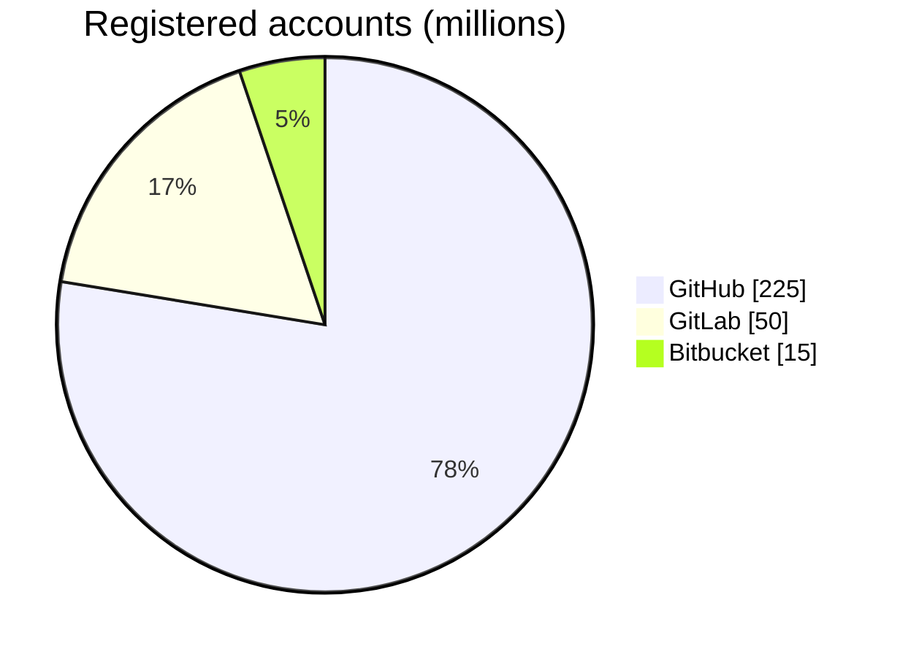
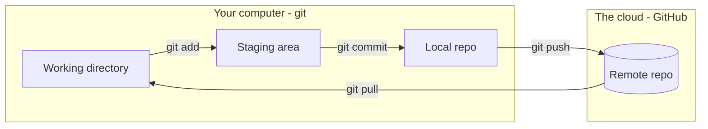
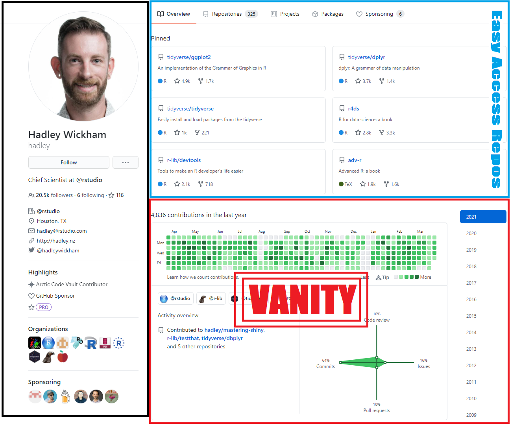
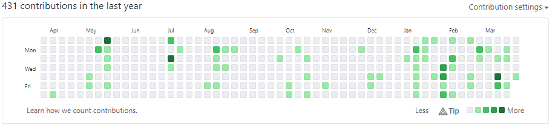
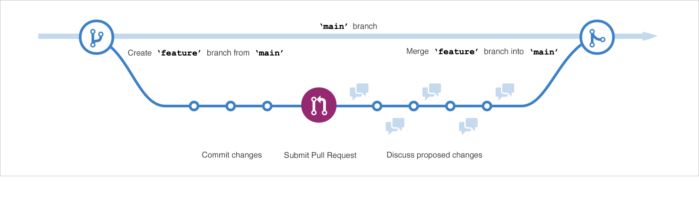
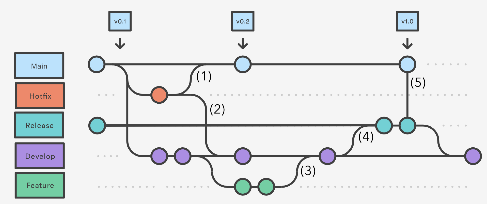

# Are You Having Trouble Gitting It?

## Preamble

*[xkcd 1597](https://xkcd.com/1597/) by Randall Munroe, CC BY-NC 2.5*

**Nobody memorizes git.**

## Goal
**Today:** The on-ramp
* History
* Motivation
* Jargon
* Under the hood
* GitHub is social media
* The standard workflow
* Live demo

**Tomorrow:** Practice, Practice, Practice
* [GitHub badge](../../badges/github.md)
<!-- TODO: add the rest of tomorrow's plan here -->

## History

| Year | What happened |
|---|---|
| **2005** | Linus Torvalds writes git |
| **2008** | GitHub launches |
| **2018** | Microsoft buys GitHub for $7.5B |
| **2021** | GitHub Copilot |
| **2026** | AI agents open over 40% of pull requests |

### Why Linus Torvalds made git

| Principle | What it means | Why it won |
|---|---|---|
| **Fast** | Branching and merging take seconds | Trying an idea is cheap, so people try ideas |
| **Distributed** | Every copy holds the whole history | Work offline, no single point of failure |
| **Trust nothing** | Every version is checksummed | History cannot be changed quietly |
| **Free** | Open source, no license to lose | Anyone can adopt it and build on it |

* Linux proved it at scale. The design is why everyone else followed.

### Who won?

*Self-reported and overlapping - plenty of people have more than one account.*

* GitHub is dominant, but it is not the only player
* **GitLab** - host it yourself
* **Bitbucket** - pairs with Jira
* **SourceForge** - the old guard

### And now: AI
* March 2026 - agents open **17%** of pull requests
* September 2026 - agents open **over 40%**
* The workflow below is the same one the agents use

## Motivation - Two Birds, One Stone

1. **Collaboration** - the industry standard for working on code together
2. **Portfolio** - show off the work you did

## Jargon

| | Term | What it is |
|---|---|---|
|  | **git** | Software - version control |
|  | **GitHub** | Company - owned by Microsoft |
|  | **github.com** | Website - the front end |

| Term | Belongs to | Think of it as |
|---|---|---|
| repository (repo) | git | Project folder + its whole history |
| commit | git | A save point with a note |
| branch | git | A parallel timeline |
| fork | GitHub | Your own copy of someone else's repo |
| pull request (PR) | GitHub | "Please take my changes" |
| README | General computing | The welcome mat |

## Under the Hood

**git** runs on your computer. **GitHub** is the copy in the cloud.

### The few moves

| Command | What it does | Talks to GitHub? |
|---|---|---|
| `git clone` | Get a copy | Yes |
| `git status` | Where am I? | No |
| `git add` | Stage it | No |
| `git commit` | Save point | No |
| `git push` | Send it up | Yes |
| `git pull` | Bring it down | Yes |

## GitHub is Social Media

**Put yourself on high alert.** All the pitfalls of social media lurk just under the surface.

### Let's look at a profile
<!-- https://github.com/UVADS/orientation-technical/blob/main/workshops/zzold/lessons/arXiv/lesson-github.md -->

* **Black box** - contact info
* **Blue box** - pinned repositories, what you choose to highlight
* **Red box** - the commit graph - **WARNING!!!**

### Data science thinking time - the commit graph

1. What questions **can** we answer from this data?
2. What questions can we **not** answer?
3. What additional data would move a question from 2 to 1?

### Bend it to your purpose
* **Portfolio** - pin your best work, write the README
* **Networking** - follow faculty, alumni, projects you use
* **Shields up** - profiles can discourage and intimidate. Have a friend to talk to.

## The Standard Workflow

You are a data scientist. This is the loop you will see every day.

| Step | What you do | Whose word |
|---|---|---|
| 1. **Fork** | Not your repo? Make your own copy first | GitHub |
| 2. **Branch** | Step off of main | git |
| 3. **Commit** | Save points | git |
| 4. **Pull request** | Ask to come back | GitHub |
| 5. **Review** | A human (or an agent) looks | GitHub |
| 6. **Merge** | Back on main | git |

* Your own repo? Skip step 1.

<!-- TODO: workflow graphic goes here - see To-do -->

## Live Demo - Clicking on Everything
* README
* Commits and history
* Blame
* Branches
* Issues
* Pull requests
* Edit a file in the browser &rarr; commit &rarr; PR
* Insights

## Homework

### Earn the [GitHub badge](../../badges/github.md)

## When in doubt, see the [Preamble](#preamble)

## To-do
*Speaker notes - remove before the talk.*

- [ ] **Software, not data** - git is version control for software and GitHub hosts software. Neither is where the data lives. Find the right moment in the talk for this.
- [ ] **Commit graph questions** - this is a presentation, not a workshop. Decide how to deliver the three questions. The old lesson had a fourth: what data would make the answers to question 1 more accurate?
- [ ] **"Think of it as" column** - rewrite, it can be better.
- [ ] **Workflow graphic** - find one made by GitHub. Candidate: the [GitHub flow picture on Microsoft Learn](https://learn.microsoft.com/en-sg/training/modules/introduction-to-github/3-components-of-github-flow). Check reuse terms before embedding.

# Sources
* github workflow figure - https://learn.microsoft.com/en-sg/training/modules/introduction-to-github/3-components-of-github-flow
* github workflow figure - https://izymes.com/wp-content/uploads/2022/06/pr-dependencies-git-flow.png    
